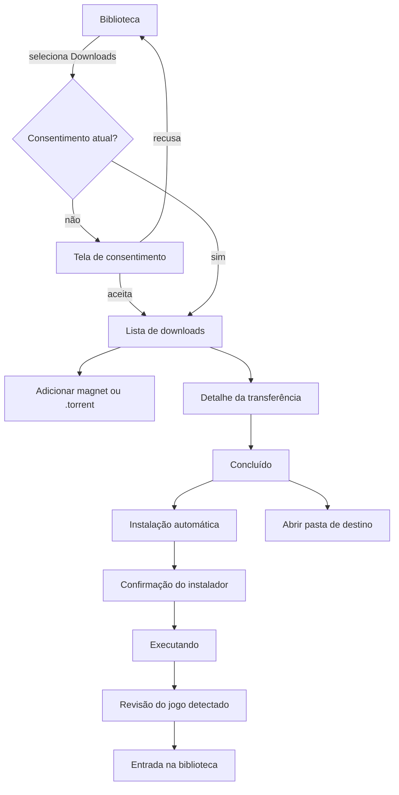

# Design

## Context

See `proposal.md` — Why.

The desktop app is Tauri v2 with a React/Tailwind shell and a Rust host split into `core` (domain), `platform` (OS adapters and SQLite), `api` (GameNode HTTP) and `app` (engine, commands, windows). The shell currently renders one signed-in view, `LibraryScreen`, and persists library layout in SQLite. Local DRM-free registrations use the `manual` provider and are Windows-only today; that gap is one reason Linux automatic installation is deferred (D9).

Two existing constraints shape this design:

- The host already isolates work behind ports (`HostFiles`, `UriOpener`, `Processes`, `PlaytimeStore`) with in-memory doubles. Downloads must follow that pattern, not reach into Tauri from domain code.
- Tauri application commands are callable from every webview unless `AppManifest::commands` is declared. This change adds no new webview, so the single-window assumption still holds; the design deliberately avoids remote content.

`rqbit` 9.x is a pure-Rust BitTorrent client and server, Apache-2.0, with an HTTP API, Basic Auth through `RQBIT_HTTP_BASIC_AUTH_USERPASS`, DHT, PEX, uTP, UDP trackers, fastresume, rate limits, UPnP and session persistence. Its own desktop app is Tauri, which validates the sidecar-plus-HTTP shape.

## Goals / Non-Goals

**Goals**

- A downloads surface that works on a machine with no torrent client, with the engine shipped and versioned with the app.
- A consent boundary the user cannot cross by accident, and an engine that is completely absent while the feature is off.
- A single installer pipeline that turns a completed transfer into a normal DRM-free library entry, so matching, launch, playtime (where supported), repair and removal keep working.
- An implementation that can replace the engine without rewriting the UI, and can replace the installer strategy without changing the transfer surface.

**Non-Goals**

- Search, indexers, RSS, recommendations or any source catalog.
- qBittorrent or any external client integration.
- Deleting downloaded files from the UI.
- Linux automatic installation, Proton/Wine integration, and Wine/Proton-backed entries; this work resumes only after that integration is configured and functional.
- Playtime tracking and save backups for Wine/Proton entries, which belong to the deferred work.
- Silent installers, unattended component selection or installer argument inference beyond what the user confirms.
- Automatic re-running of an installer after a crash.
- macOS.

## Decisions

### D1. rqbit as a bundled sidecar, not a library

**Decision:** Ship `rqbit` as a Tauri `externalBin` sidecar per target triple; the host talks to it over an authenticated loopback HTTP API.

**Why:** Process isolation contains engine crashes and third-party bugs; the HTTP boundary keeps the engine replaceable and testable with `wiremock`; the binary is versioned with the app, so no separate update channel exists. A library integration would remove the process and port, but a panic or storage bug would take the UI down with it, and the engine's lifetime would be tied to the UI's.

**Alternatives:** `librqbit` linked in-process (simpler deployment, weaker isolation); `libtorrent` FFI (mature, but boost/b2 and C++ packaging); a sidecar process we write ourselves (more work, no benefit over rqbit's server).

**Constraint:** rqbit's feature list has gaps relevant to real swarms — no documented MSE/PE encryption, sequential-only download, and unclear Windows interface binding for VPN users. These are accepted for v1 and documented; the port isolates a later swap.

### D2. Engine lifecycle is host-owned

**Decision:** A supervisor in `crates/app` owns spawn, readiness, polling, restart and shutdown. The frontend never spawns or addresses the sidecar directly.

**Lifecycle:**

1. Consent accepted and first use requested.
2. Host picks a free loopback port (`TcpListener::bind("127.0.0.1:0")`), generates a random Basic Auth pair, and spawns `rqbit --http-api-listen-addr 127.0.0.1:<port> server start <data>/downloads --persistence-location <data>/downloads/engine --fastresume`.
3. Host polls `GET /` until ready (bounded, with timeout).
4. Poller reads `GET /torrents` and `GET /torrents/{id}/stats/v1` every 2 s while the window is visible and every 20 s while hidden; it emits `downloads:view`.
5. On disable or Quit, the host pauses active torrents through the API, then terminates the child; rqbit's persistence keeps resumable state.
6. A crash triggers restart with exponential backoff; repeated failures stop automatic restarts and surface a manual retry.

**Orphans:** a lockfile records PID, port and start time. On startup the host checks whether the recorded process is alive and answers the API; if so it reuses it, otherwise it removes the lockfile. On Windows the child is assigned to a Job Object with `JOB_OBJECT_LIMIT_KILL_ON_JOB_CLOSE` so an app crash cannot leave it running.

**Auth:** the random `user:pass` exists only in host memory and the child environment. Errors and logs never include it. The API is never exposed beyond loopback in v1.

### D3. Engine-agnostic port

**Decision:** `TorrentEngine` in `crates/core/src/ports.rs` exposes status, list, add, pause, resume, forget, files, file selection and session stats. `crates/app/src/downloads/rqbit.rs` implements it.

**Why:** The UI, install pipeline and association logic must not know rqbit's dialect. A future engine swap becomes an adapter change. Tests use an in-memory engine with a gate, like the existing `FakeUri`/`FakeLibrary` doubles.

### D4. Separate event channel, not the library snapshot

**Decision:** Emit `downloads:view` on its own channel and hold it in the TanStack Query cache; do not add downloads to `engine:snapshot`.

**Why:** Transfer progress changes every second; republishing the library snapshot would invalidate library queries and cost more than the feature. The badge reads the same cache, so one source feeds list and navigation.

**Payload:** `DownloadsView { engine, consent, transfers, selectedFiles, installJob }`. Engine-owned transfer detail stays in the engine; the host only aggregates what the UI needs.

### D5. Consent is a versioned, stored gate

**Decision:** `DOWNLOADS_TERM_VERSION` lives in core. Consent is a row in `download_preferences` with version and timestamp. Enabled is a separate flag. Feature is off and the engine absent unless both consent is current and enabled is true.

**Why:** A version bump can re-prompt without wiping preferences; a corrupt or missing row can only fail closed. The consent screen is a page in the Downloads section, not a modal, so it can carry the required text and remain readable at the minimum window size.

**Two separate confirmations:** the feature term and the per-install confirmation. Accepting the feature never authorizes running an installer.

### D6. Navigation split without a router

**Decision:** Add `section: 'library' | 'downloads'` to `uiStore`, default `library`. `App.tsx` renders `LibraryScreen` or `DownloadsScreen`. The sidebar renders section navigation above the library-specific filters; filters are hidden in Downloads. The app always opens on Biblioteca, as the shell spec requires.

**Why:** The app has no router and does not need one. Keeping section state in the existing store preserves the library's own state and the Settings modal across switches.

**Badge:** counts transfers in `metadata`, `downloading`, `paused` (active intent) plus `completed` transfers with no association and no dismissal. It is derived from `downloads:view`, not stored.

### D7. Install job is a persisted state machine

**Decision:** Model the install as phases, not a single progress number:

`discovering → confirming → preparing → running → detecting → reviewing → registering → done | failed | cancelled`.

**Why:** A torrent download, an installer and a detection scan have incompatible progress metrics. The UI shows a stepper; each phase reports its own state. Persisting the phase lets the app reconcile after a crash and prevents an installer from being re-run automatically.

**Concurrency:** one installer at a time; transfers continue. Starting a second install returns a localized conflict.

### D8. Windows detection uses a bounded evidence strategy

**Decision:** Before running the installer, snapshot the top-level entries and modification times of a bounded candidate set: the chosen destination, `%ProgramFiles%`, `%ProgramFiles(x86)%`, `%LOCALAPPDATA%\Programs`, `%APPDATA%` and the transfer folder. After the installer exits, recurse only into new or changed top-level folders, with depth and time limits. Use the existing DRM-free discovery evidence (PE product/description metadata, meaningful executable names, installation context) to rank candidates. Registry uninstall entries are a secondary signal for installs outside the candidate set.

**Why:** Scanning all of `C:\` is unacceptable. A diff plus the existing evidence rules is fast, bounded and reuses tested code. The chosen destination is a hint, not a guarantee: generic installers may ignore it, so detection must not depend on it.

**Confirmation:** even an unambiguous result is proposed for review; nothing is added silently. This also handles installers that create multiple entries.

### D9. Linux automatic installation is deferred

**Decision:** This change does not detect Proton or Wine, create prefixes, run Linux installers, or register Wine/Proton-backed entries. Downloads and the rqbit sidecar remain available on Linux, but the automatic installation action is disabled with a localized explanation and the folder action remains.

**Why:** Prefix creation, runtime detection, launch registration, process tracking and save handling under Wine/Proton form a separate subsystem with its own failure modes. Shipping a partial version would create half-playable entries and misleading support expectations.

**Condition to resume:** Linux automatic installation SHALL be revisited only after the Proton/Wine integration is configured and functional, and not before. That future change owns runtime detection, prefix lifecycle, launch registration, tracking and save behavior.

**Still available on Linux:** the Downloads section, consent, engine lifecycle, transfer list and detail, pause/resume/forget, open folder, and the completed handoff with the install action disabled.

### D10. Installed games become ordinary DRM-free entries

**Decision:** The terminal state of a successful install is a `manual` entry with the detected executable and `origin` provenance (info hash). The entry key remains `manual:<installation id>`. Runtime fields for Wine/Proton are not added in this change; the deferred Linux work will own them.

**Why:** Matching, launch, repair, removal and the library UI already work for `manual` entries. A parallel `download` provider would duplicate all of it and fork identity rules. Provenance stays local and is never sent to GameNode.

**Duplicate rule:** the canonical executable comparison used today applies, so re-installing the same game selects the existing entry.

### D11. No delete-with-files, no silent install

**Decision:** `forget` keeps files; there is no delete-files action. Installers always run visibly, without silent arguments, and with a per-install confirmation showing path, size, SHA-256 and publisher.

**Why:** Both are irreversible actions with legal and data-loss consequences. Keeping them out of v1 removes the two worst failure modes and keeps the UI honest.

**MOTW:** the Windows host marks the installer executable with `Zone.Identifier` (`ZoneId=3`) where the filesystem supports it, so SmartScreen and Defender can evaluate it; failures to write the stream are logged and do not block the user's explicit choice. The app never suppresses OS security prompts.

### D12. Data model and migration `0007_downloads.sql`

**Tables:**

- `download_preferences` (single row): `enabled`, `consent_version`, `consent_accepted_at`, `destination`, `download_limit`, `upload_limit`, `seeding_policy`, `peer_port`, `updated_at`.
- `download_associations`: `info_hash` PK, `entry_key`, `content_path`, `associated_at`.
- `install_jobs`: `id` PK, `info_hash`, `phase`, `installer_path`, `installer_sha256`, `exit_code`, `error`, `created_at`, `updated_at`.

Consent is fail-closed: a missing, corrupt or older version means disabled. Engine-owned state stays in `<data>/downloads/engine`; the database never duplicates transfer progress. Completed `install_jobs` older than 30 days are pruned.

**Rollback:** migrations are forward-only, consistent with `desktop-local-state`. Disabling the feature is the rollback; a previous binary cannot open the migrated database.

### D13. Polling, performance and UI-thread rules

- All engine, filesystem, hashing, registry and process work runs on Tokio or blocking worker threads; commands are `async`.
- The poller coalesces concurrent ticks; a slow engine response does not queue more requests.
- The UI renders at most one `downloads:view` per tick and uses keys by info hash to avoid remounting rows.
- File lists are fetched lazily for the selected transfer, not for every row.
- The engine is stopped when the feature is disabled; polling stops with it.

### D14. Packaging and CI

- `bundle.externalBin: ["binaries/rqbit"]`, with `rqbit-x86_64-pc-windows-msvc.exe` and `rqbit-x86_64-unknown-linux-gnu` (glibc baseline). The sidecar ships on both platforms; automatic installation is Windows-only in this change.
- CI downloads a pinned rqbit release, verifies SHA-256, renames with the target triple and fails the build if the binary is missing. Building from source is the fallback if upstream artifacts are unavailable.
- The sidecar is covered by the app installer's signature; the binary itself is code-signed on Windows for reputation.
- rqbit's Apache-2.0 notice joins the bundled license notices and the Settings/About surface.

## Screens and flows

### Flow overview

### Screen inventory

| Screen | Entry point | Content | Primary actions | Key states |
| --- | --- | --- | --- | --- |
| Consent | First Downloads selection, or any add attempt | What the feature does, bundled rqbit and license, peer IP visibility, user responsibility, no content provided, disk use, disable path, term version | Aceitar e ativar; Voltar para a biblioteca | Unchecked/checked; read error |
| Downloads list | Sidebar Downloads | Engine pill, global speeds, filters (Ativos/Concluídos/Todos), rows with name/state/progress/size/speed/ETA/peers | Adicionar; pause/resume; open folder; forget; details | Empty; loading; engine starting; engine error; off |
| Add transfer | Adicionar button or clipboard | Magnet field, choose `.torrent`, destination, inline validation | Adicionar; Cancelar | Valid; malformed; duplicate; metadata waiting |
| Transfer detail | Select a row | Info hash, destination, total size, files with sizes and selection, per-file progress | Pause/resume; apply file selection; forget; open folder | Metadata pending; downloading; paused; seeding; error |
| Completion card | Completed row/detail | Two primary actions; associated entry shortcut | Instalação automática; Abrir pasta de destino; Ver na biblioteca; Dispensar | Not handled; associated; dismissed |
| Install confirmation | Instalação automática | Installer path, size, SHA-256, publisher, warning, consent checkbox | Executar instalador; Cancelar | Missing hash; unknown publisher |
| Installing | After confirmation | Phase stepper, elapsed time, note that the installer has its own window, cancel with warning | Parar instalação | Preparing; running; cancelling |
| Detecting | Installer exit 0 | Indeterminate progress and bounded scan status | — | Detected; ambiguous; none |
| Install review | Detection result | Inferred title (editable), folder, executable, candidate list when ambiguous | Adicionar à biblioteca; Escolher executável; Abrir pasta; Descartar | Unique; ambiguous; portable; none |
| Settings → Downloads | Settings modal | Engine status/version/retry, enable toggle, destination, limits, seeding, license | Salvar destino; Tentar novamente; Desativar | Ready; stopped; error |

### Consent screen

A page in the content area, not a modal. It starts with the title "Downloads no GameNode" and a short lead, then five short sections with headings: what it does; the bundled engine and its license; what other peers can see (IP and info hash); what the user is responsible for; and how to turn it off. A checkbox reads "Entendo que o GameNode não fornece conteúdo e que sou responsável pelo que baixar." The primary button "Aceitar e ativar" is disabled until checked; "Voltar para a biblioteca" is secondary. The term version and date appear in small text at the bottom.

When the screen is reached from an add attempt, accepting returns to the add dialog with the pending input preserved. Declining returns to the previous section and discards the pending input.

### Downloads list

Header: title, engine status pill (Pronto / Iniciando / Parado / Erro), aggregate download and upload speed, and a primary "Adicionar" button. A secondary "Colar magnet" reads the clipboard and opens the add dialog prefilled.

Rows are compact and show: name, state chip, progress bar, size, speed, ETA and peers. Completed rows expand into the completion card with the two buttons. The overflow menu holds pause/resume, open folder, forget and details. The multi-select pattern from the library is not used; transfers are operated one at a time.

Empty state: a short explanation, "Adicionar magnet", "Colar da área de transferência", and a link to the consent term.

Engine error state: the list keeps its rows visible but marks them unavailable, shows the localized error and a "Tentar novamente" action.

### Transfer detail

A right-hand pane, consistent with the library's detail pane. It shows the name, info hash (monospace, copyable), state, destination, total size, and the files table once metadata arrives. Files have checkboxes and sizes; toggling them calls the engine's file-selection action. Per-file progress is shown only when useful. The destination control is enabled only before any bytes are written; otherwise it shows a lock reason.

### Completion handoff

The card is the only place with the two primary buttons, and it is repeated in the detail pane for discoverability. "Abrir pasta de destino" reveals the content path in the OS file manager and creates nothing. "Instalação automática" opens the install confirmation. When the transfer is associated, the card shows "Adicionado à biblioteca" with "Ver na biblioteca" (switches to Biblioteca and selects the entry) and keeps "Abrir pasta".

"Instalação automática" is disabled with a reason when: no installer and no recognized portable game; automatic installation is not available on this platform; another install job is running; the engine is unavailable. The folder action remains in every case.

### Install confirmation

A modal over Downloads. It shows the installer name and path, size, SHA-256 (truncated with a copy action), publisher metadata when present, and a warning that the installer runs with the user's privileges and that the app cannot vouch for its content. A checkbox "Entendo que este instalador será executado no meu computador" gates the primary "Executar instalador" button. Cancel is the default focus.

### Installing, detecting and review

The modal becomes a stepper: Preparando, Executando, Detectando, Revisando. During Executando the installer's own window is visible; the app does not hide it or automate it. "Parar instalação" asks for confirmation, terminates the child process and marks the job cancelled; the transfer stays completed.

Review reuses the visual language of the existing discovery review: title field, folder and executable. When ambiguous, a candidate list appears; choosing one updates the fields. "Adicionar à biblioteca" persists the entry and starts background matching. "Descartar" leaves everything on disk and returns to the completion card.

### Settings → Downloads

Cards: Engine (status, version, retry), Destination (path, change, validation), Limits (download/upload), Seeding (while running / stop when complete), License (rqbit, Apache-2.0, link to notices), and Disable. Disabling stops the engine, leaves data resumable, and keeps the consent term so re-enabling does not re-read it unless the term changed.

## Risks / Trade-offs

- **rqbit feature gaps** (no documented MSE encryption, sequential-only, unclear Windows interface binding) → document in `docs/downloads.md`, expose engine name/version, keep `TorrentEngine` replaceable; revisit if users report throttling or VPN leaks.
- **Linux installation is deferred** → Downloads ships on Linux with the install action visibly disabled; copy, specs and Settings never claim Proton/Wine support, and the deferred work is tracked separately.
- **Installer execution is the highest-risk action** → per-install consent, SHA-256, publisher, visible window, no shell, no auto-elevation, Job Object containment, no auto-run after a crash.
- **Detection heuristics can miss** → bounded diff plus existing evidence, always reviewed by the user, manual executable fallback.
- **Antivirus reputation** → code-sign the sidecar, pin and verify upstream artifacts, never suppress Defender or SmartScreen.
- **Orphan sidecar** → Windows Job Object, lockfile reuse/kill on Linux, explicit shutdown.
- **Port conflicts** → ephemeral API port with retry; persisted peer port with fallback.
- **Disk pressure** → free-space check before add where metadata allows, localized disk-full handling, no deletion from the app.
- **Deferred scope leaks into copy or settings** → installation is described as Windows-only; acceptance checks that no Linux control claims Proton/Wine support.
- **Forward-only migrations** → disabling the feature is the rollback; a previous binary cannot open the migrated database.
- **Legal exposure** → no discovery, no hosting, no recommendations, no transfer metadata to GameNode, direct distribution only; counsel before commercial release.
- **Engine persistence format changes across rqbit versions** → pin versions, test upgrades, and if state cannot be read, keep files and reset the engine state with a clear message.

## Migration Plan

1. Add migration `0007_downloads.sql`; the feature ships disabled, so existing installs behave exactly as before.
2. Add the rqbit sidecar to CI and packaging; verify target-triple names and executable bits before merging.
3. Add core ports and the fake engine first, then the rqbit adapter, then the supervisor, then UI.
4. Enable through consent only; no automatic migration of existing users.
5. Rollback: disable the feature through Settings or a build flag; files and engine state remain under the data directory. Database rollback is not supported, consistent with the existing policy.

## Open Questions

- Should the default seeding policy expose a ratio option in v1, or only "while running" and "stop when complete"? The spec fixes the default; the extra option is additive.
- Should completed install jobs be shown in a history section, or is the completion card enough? The data model supports either.
- Should the Downloads section be available signed out? The shell is signed-in today; this change keeps that boundary.
