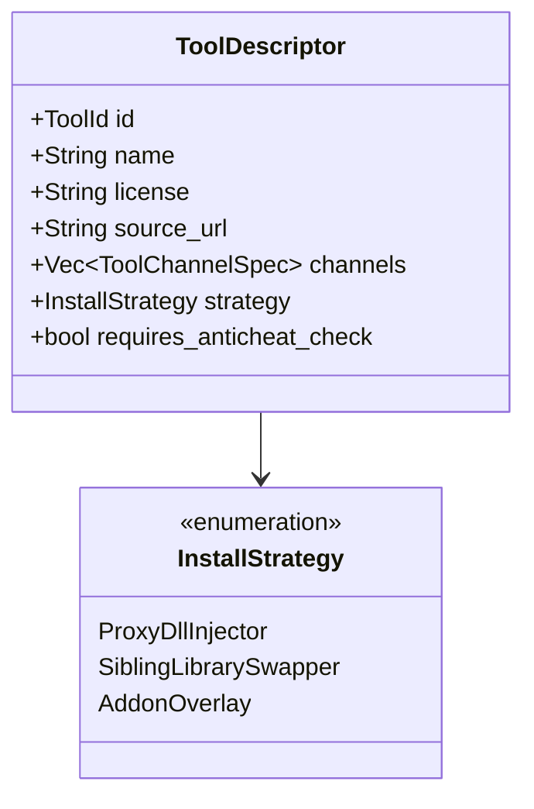
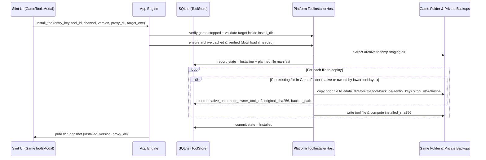

# Design

## Context

GameNode Desktop already discovers installed games across providers (`steam:<id>`, `manual:<id>`, and upcoming stores in step 4b/5), tracks running processes via `Processes`, and manages local per-game save backups via `Ludusavi` in `crates/platform`. Step 7 of the MVP roadmap (`docs/mvp-roadmap.md`) is OptiScaler installation per game, and the user wants to prioritize this now while building a scalable Game Tools architecture that will also power **MFG Unlocker**, **DLSS / FSR 4 Swapper** (including DLSS/XeSS/FSR DLL swapping and replacing a game's or OptiScaler's FSR 4 DLL with **FSR 4 RDNA 2 Lite**), **AMD NR Launcher**, and **AeonSR** without re-architecting persistence, archive caching, executable discovery, or rollback later. See `proposal.md` for motivation and scope.

## Goals / Non-Goals

**Goals:**
- Establish a unified, declarative **Game Tools Engine** (`crates/core/src/tools` + `crates/platform/src/tools`) that abstracts release fetching, content-addressed archive caching, target game executable resolution, anti-cheat and cross-tool conflict/composition checks, and transactional file deployment with byte-identical rollback.
- Ship complete, production-ready **OptiScaler** support (`Stable` and `Nightly` channels, `.7z` extraction in pure Rust, proxy DLL selection from the OptiScaler wiki list starting with `dxgi.dll`, `OptiScaler.ini` preservation on updates, anti-cheat warning for EasyAntiCheat/BattlEye/blocklist, and byte-identical uninstall).
- Ensure every future tool archetype (`ProxyDllInjector` for tools like OptiScaler/AeonSR/MFG Unlocker, `SiblingLibrarySwapper` for tools like DLSS Swapper and FSR 4 → FSR 4 RDNA 2 Lite DLL replacement, and `AddonOverlay`) plugs into the same traits, SQLite tables, layered rollback ledger, and UI modal without schema changes.

**Non-Goals:**
- Implementing live release fetching or user-facing cards for MFG Unlocker, DLSS / FSR 4 RDNA 2 Lite Swapper, AMD NR Launcher, or AeonSR in this change (their `InstallStrategy` variants, registry slots, and layered composition rules with OptiScaler are designed and tested via unit tests now, while only OptiScaler is enabled as a user-facing tool in this change).
- Executing `.bat`, `.cmd`, `.ps1`, or `.sh` scripts bundled inside tool archives (such as `OptiScaler Setup.bat` or `Remove OptiScaler.bat`). GameNode Desktop performs all DLL renaming, config preservation, and rollback deterministically in Rust.
- Linux `WINEDLLOVERRIDES` injection or Steam launch-option copying (deferred to the Linux milestone per `docs/mvp-roadmap.md`).

## Decisions

### 1. Declarative Tool Descriptors & Three Core Install Strategies (`core::tools`)

**Decision:** Represent every tool in `core::tools` with a static/declarative `ToolDescriptor` and model deployment behavior through an `InstallStrategy` enum rather than ad-hoc per-tool code paths:

1. **`ProxyDllInjector` (OptiScaler, AeonSR, MFG Unlocker proxy mode, AMD NR bridge/fork)**:
   - Targets the directory containing the game's resolved main executable (`exe_dir`).
   - Identifies the primary payload DLL inside the extracted archive from an ordered candidate list (`["OptiScaler.dll", "nvngx.dll"]` for OptiScaler; tool-defined candidate names for injectors like AeonSR) and renames it to the selected proxy DLL name.
   - Ordered supported proxy filenames from the OptiScaler wiki:
     1. `dxgi.dll` (default)
     2. `winmm.dll`
     3. `version.dll`
     4. `d3d12.dll`
     5. `dbghelp.dll`
     6. `wininet.dll`
     7. `winhttp.dll`
   - Extracts companion files and directories (`OptiScaler.ini`, `fakenvapi.dll`, `fakenvapi.ini`, `dlssg_to_fsr3_amd_is_better.dll`, `libxess.dll`, `amd_fidelityfx_*.dll`, `D3D12_OptiScaler/**`, `streamline/**`) relative to `exe_dir`.
   - Filters out interactive scripts and uninstaller batch files (`*.bat`, `*.cmd`, `*.sh`, `*.ps1`) so the game folder stays clean and under GameNode's ledger control.
   - Marks `OptiScaler.ini` (and `fakenvapi.ini`) as `PreservedConfig` so version updates keep user tweaks unless `reset_config` is requested.

2. **`SiblingLibrarySwapper` (Future DLSS / FrameGen / Ray Reconstruction / XeSS / FSR 4 & FSR 4 RDNA 2 Lite Swapper)**:
   - Supports two target resolution modes declared in `SiblingLibrarySwapper`:
     - **Standalone Game SDK Scan (`NativeInstallDir`)**: Scans `install_dir` for existing target SDK binaries (e.g., `nvngx_dlss.dll`, `nvngx_dlssg.dll`, `nvngx_dlssd.dll`, `libxess.dll`, `amd_fidelityfx_upscaler_dx12.dll`, `amd_fidelityfx_dx12.dll`, `amd_fidelityfx_framegeneration_dx12.dll`), backs up each matched file into the rollback ledger, and writes the selected version's or variant's DLL (such as replacing a game's stock FSR 4 DLL with an **FSR 4 RDNA 2 Lite** build) in place.
     - **Companion Injector Layer (`CompanionOrNative`)**: When paired with an active `ProxyDllInjector` (such as OptiScaler or AeonSR), allows replacing or providing the upscaler DLL in `exe_dir` (e.g., placing `amd_fidelityfx_upscaler_dx12.dll` / `amd_fidelityfx_dx12.dll` for FSR 4 RDNA 2 Lite next to OptiScaler even if the unmodded game only shipped with DLSS or FSR 2/3).

3. **`AddonOverlay` (OptiScaler ASI plugins like MFG Unlocker, ReShade `.addon64`, or AMD NR NeuralHub runtime overlay)**:
   - Supports two deployment modes for tools that can either run standalone or attach as a plugin to an installed `ProxyDllInjector` (such as OptiScaler):
     - **OptiScaler ASI Plugin Mode (`HostPlugin { host_tool_id: "optiscaler", plugin_dir: "plugins", extension: ".asi", ini_patches }`)**:
       - Places the payload binary into `<exe_dir>/plugins/<name>.asi` (renaming `.dll` → `.asi` when required by the tool's archive layout, and deploying any companion plugin config/files).
       - Applies declarative, reversible INI mutations (`IniPatch`) to the host tool's config file (`OptiScaler.ini`), specifically setting `LoadAsiPlugins = true` (and `Path = .\plugins` if needed) under `[Plugins]` via a surgical line/section editor that preserves all existing user comments, formatting, and unrelated tweaks.
       - Records the pre-patch value of `LoadAsiPlugins` (`auto`, `false`, or absent) in the rollback ledger. When the plugin is uninstalled—and no other installed `AddonOverlay` plugin still depends on `LoadAsiPlugins = true`—restores the key in `OptiScaler.ini` to its prior value and removes `<exe_dir>/plugins/` if empty.
     - **Standalone / Companion Overlay Mode**: When OptiScaler is not installed (and the tool supports standalone proxy injection, such as MFG Unlocker's standalone proxy mode), falls back to `ProxyDllInjector` or prompts to install OptiScaler first when the tool is strictly an addon.

**Rationale:** By encoding these three strategies, layered companion composition, and surgical `OptiScaler.ini` `[Plugins]` patching in `core::tools` now, adding MFG Unlocker (as an OptiScaler `.asi` plugin or standalone injector), AeonSR, FSR 4 RDNA 2 Lite DLL swapping, DLSS Swapper, or AMD NR Launcher in subsequent changes requires only adding their `ToolDescriptor` and release feed mapping.
**Alternatives considered:** Building a hardcoded `optiscaler` module in `platform` and refactoring later, or overwriting the entire `OptiScaler.ini` from a template when enabling plugins. Rejected because overwriting `OptiScaler.ini` would destroy user tweaks, whereas surgical section/key patching (`[Plugins] LoadAsiPlugins=true`) is non-destructive and cleanly reversible.

### 2. Universal Target Executable Resolution Across All Providers

**Decision:** Proxy DLL tools like OptiScaler must sit next to the *real* game binary (e.g., `<install_dir>/GameName/Binaries/Win64/GameName-Win64-Shipping.exe` for Unreal Engine games, or `<install_dir>/bin/x64/Cyberpunk2077.exe`), not in the top-level `install_dir` where a small bootstrapper or launcher often lives.
We will extract and share the executable discovery and ranking logic already proven in `crates/platform/src/discovery.rs` and `crates/core/src/drm_free/identity.rs` (`preferred_target`):
- For `manual:<id>` entries: default to `registration.executable` (or the first `registration.gameplay` binary), while still listing other discovered executables in `registration.root` as selectable alternatives.
- For store entries (`steam:<id>`, etc.): walk `install_dir` (up to depth 6, skipping symlinks and known maintenance/redistributable binaries via `identity::maintenance`), validate 32/64-bit PE headers via `installations::validate`, and rank candidates using:
  1. Ludusavi manifest `launch` hints when the game title matches `ManifestIndex`
  2. Role rank (non-maintenance, non-launcher/non-bootstrap first—preferring `*-Win64-Shipping.exe` over a root `Launcher.exe`)
  3. PE architecture (`0x8664` 64-bit preferred over `0x14c` 32-bit)
  4. Path depth and deterministic lexical tie-breaking
- The resolved target executable and its parent folder (`target_dir`, relative to `install_dir`) are shown in the `GameToolsModal` with a dropdown/picker when multiple executables exist so the user can override the target before installing.

**Rationale:** Reusing `preferred_target` and PE validation avoids duplicating heuristics and solves the #1 cause of broken OptiScaler installs (placing `dxgi.dll` next to an Unreal Engine root bootstrap `.exe` instead of `Binaries/Win64/*-Shipping.exe`).

### 3. Anti-Cheat Inspection & Explicit Pre-Install Warning

**Decision:** Before installing any tool with `requires_anticheat_check = true`, `ToolInstallerHost::inspect_target` scans `install_dir` (and checks a bundled blocklist of known online anti-cheat Steam app IDs / titles) for:
- **EasyAntiCheat**: directory named `EasyAntiCheat`, or files matching `EasyAntiCheat*.exe`, `EasyAntiCheat*.dll`, `install_easyanticheat*`.
- **BattlEye**: directory named `BattlEye`, or files matching `BEService*.exe`, `BEClient*.dll`, `Install_BattlEye*`.
- **Bundled Blocklist**: a curated static list in `core::tools::anticheat` for major competitive games whose anti-cheat may reside outside standard folder names.
If any marker is found, `AntiCheatReport` returns the detected systems (`EasyAntiCheat`, `BattlEye`, `Blocklisted`). In the UI, the tool card displays a high-visibility warning (`InfoBox` / `AlertDialog` with `warning`/`danger` styling) and requires an explicit confirmation step (`"Install anyway"`) before any files are written.

**Rationale:** Directly satisfies the roadmap requirement ("Anti-cheat block: warn if the game folder contains EasyAntiCheat or BattlEye, or the game is on our blocklist. An explicit warning before any install.") while keeping the user in control for offline/modded modes.

### 4. Fixed GitHub Release Sources, Caching, and Pure-Rust `.7z` Extraction

**Decision:**
- **Fixed HTTPS Sources:** In accordance with the security rules in `docs/mvp-roadmap.md`, release queries and asset downloads only talk to HTTPS URLs matching the repositories declared in `ToolDescriptor`:
  - OptiScaler Stable: `https://api.github.com/repos/optiscaler/OptiScaler/releases` (and asset host `https://github.com/optiscaler/OptiScaler/releases/download/...` / `objects.githubusercontent.com`)
  - OptiScaler Nightly: `https://api.github.com/repos/optiscaler/OptiScaler-nightly/releases`
- **Checksum Verification:** When a GitHub release asset includes a `digest` (`sha256:...` from the GitHub API or a companion `.sha256` / body checksum table), the downloaded archive is verified against that SHA-256 before caching. Regardless of whether the upstream release published a digest, GameNode computes and records the archive's SHA-256 in `tool_releases_cache` and verifies it before every extraction.
- **Pure-Rust `.7z` Extraction:** Add `sevenz-rust2` (pure Rust, no C/FFI toolchain issues when cross-compiling from WSL to Windows `x86_64-pc-windows-gnu`/`msvc`) to `crates/platform` to extract `.7z` archives safely in memory/staging, enforcing path-traversal checks (rejecting any entry with `..`, absolute paths, or symlinks) and total extracted size bounds.

**Rationale:** Pure-Rust extraction keeps WSL-to-Windows cross-builds reproducible and fast without shipping an external `7z.exe` binary.

### 5. Transactional File Deployment, Layered Tool Composition & Byte-Identical Rollback Ledger

**Decision:** All mutations to a game's folder happen on a worker thread after verifying via `Processes::list()` that no process is running inside `install_dir`.

- **Layered File Ownership (e.g., OptiScaler + FSR 4 RDNA 2 Lite Swapper) & Host INI Patching (e.g., OptiScaler + MFG Unlocker `.asi` Plugin):**
  - Two `ProxyDllInjector` tools cannot occupy the same proxy DLL filename (`dxgi.dll`) simultaneously unless the user selects a fallback proxy slot or attaches the second tool as an `AddonOverlay` plugin (such as installing MFG Unlocker into `<exe_dir>/plugins/MFGUnlocker.asi` loaded by OptiScaler).
  - A `SiblingLibrarySwapper` (such as an **FSR 4 RDNA 2 Lite** swapper replacing `amd_fidelityfx_upscaler_dx12.dll` / `amd_fidelityfx_dx12.dll`, or a DLSS swapper replacing `nvngx_dlss.dll`) CAN layer on top of either a native game file or a companion file originally deployed by an installed `ProxyDllInjector` (like OptiScaler).
  - Each `tool_files` record stores `prior_owner_tool_id` (`NULL` if the backed-up file belonged to the base game, or `<other_tool_id>` if it overwrote another tool's companion file):
    - If the top-layer swapper (e.g., FSR 4 RDNA 2 Lite) is uninstalled while OptiScaler remains installed, it restores OptiScaler's backed-up companion DLL (`prior_owner_tool_id = "optiscaler"`).
    - If OptiScaler is updated while FSR 4 RDNA 2 Lite is active on `amd_fidelityfx_dx12.dll`, the planner sees that `amd_fidelityfx_dx12.dll` is currently overridden by a higher tool layer, updates OptiScaler's shadowed backup in `tool-backups`, and leaves the active FSR 4 RDNA 2 Lite DLL untouched on disk.
    - If OptiScaler is updated (or its config is reset) while one or more `AddonOverlay` ASI plugins are installed in `plugins/`, the installer re-ensures `[Plugins] LoadAsiPlugins = true` in `OptiScaler.ini` after the update so active plugins stay enabled.
    - When an `AddonOverlay` ASI plugin is uninstalled, its `.asi` file in `plugins/` is removed, and if no other installed tool requires `LoadAsiPlugins = true`, `OptiScaler.ini` has its `[Plugins] LoadAsiPlugins` key restored to its recorded pre-plugin state (or if OptiScaler itself is uninstalled first, `OptiScaler.ini` is removed as normal while the plugin's own files in `plugins/` remain tracked for clean removal).
- **Byte-Identical Uninstall:**
  1. Verify the game is stopped and `install_dir` is canonical.
  2. For each recorded file in `tool_files` for `(entry_key, tool_id)`:
     - If another still-installed tool currently overrides this path (`prior_owner_tool_id = tool_id`), transfer this tool's base backup (`backup_path`, `original_sha256`, `prior_owner_tool_id`) to that overriding tool's `tool_files` row instead of touching the active file on disk.
     - Otherwise, delete the deployed tool file from `install_dir` (if it still exists); if `backup_path` is present, verify the backup file's SHA-256 matches `original_sha256` and restore it atomically to its exact relative path in `install_dir`.
  3. Revert any `IniPatch` entries owned by `tool_id` (such as `[Plugins] LoadAsiPlugins = true` in `OptiScaler.ini`) when no other installed tool shares that patch.
  4. Remove any subdirectories inside `install_dir` that were created by the tool (e.g., `D3D12_OptiScaler`, `streamline`, `plugins`) if and only if they are now empty.
  5. Delete the backup staging folder for `(entry_key, tool_id)` and remove the `tool_installations` / `tool_files` rows in SQLite.
- **Crash Recovery on Startup:** Just like `PlaytimeStore::recover` and backup job reconciliation, startup inspects `tool_installations` for any row in a transient state (`Installing`, `Updating`, `Uninstalling`) and executes rollback using the recorded `tool_files` backup entries before normal operation begins.

**Rationale:** Guarantees the roadmap's acceptance criterion ("install then uninstall on a test game leaves the folder byte-identical") for single-tool installs, layered DLL swappers (like FSR 4 RDNA 2 Lite or DLSS Swapper), and OptiScaler `.asi` plugins (like MFG Unlocker in `plugins/` with `LoadAsiPlugins=true`).

### 6. UI Architecture (`GameToolsModal` & `SettingsTopic.tools`)

**Decision:**
- **Detail Pane & Context Menu (`crates/app/ui/library.slint`)**:
  - Add a `Game tools…` action button in `DetailPane` (and in `ContextMenuArea` for single installed game selections).
  - When one or more tools are installed on the selected game, show a `Tools` field in `DetailPane` summarizing active tools (e.g., `OptiScaler v0.7.9 · dxgi.dll`).
- **Per-Game Modal (`crates/app/ui/tools.slint`)**:
  - Built with `SettingsStyle`, `SettingsPanelHeader`, `SettingsCard`, `SettingsRow`, `SettingsSegmented`, `SettingsButton`, `Pill`, and `InfoBox`—matching the visual language of `SettingsModal` and the redesigned `SaveProtection` modal.
  - Displays a list/stack of tool cards (starting with **OptiScaler**, with the layout structured to render additional tool cards as MFG Unlocker, DLSS, and AMD NR Launcher are registered).
  - Inside the OptiScaler card:
    - Header with tool name, installed status `Pill` (`Installed · v0.7.9` or `Not installed`), `GPL-3.0` license badge, and `Source` link button.
    - Anti-cheat warning `InfoBox` (if `EasyAntiCheat`, `BattlEye`, or blocklist detected on this game) with an explicit confirmation checkbox/dialog before install.
    - Channel segmented control (`Stable` / `Nightly`) and Version selector (with `Refresh versions` button and cached indicator).
    - Target executable selector (auto-resolved to main/Shipping `.exe`, expandable if multiple executables exist in the game folder) and Proxy DLL filename selector (`dxgi.dll (Recommended)`, `winmm.dll`, `version.dll`, `d3d12.dll`, `dbghelp.dll`, `wininet.dll`, `winhttp.dll`).
    - Primary actions: `Install`, or when installed: `Update / Apply changes` and `Uninstall`.
- **Global Settings Panel (`crates/app/ui/settings.slint`)**:
  - Add `SettingsTopic.tools` (`Tools` / `Ferramentas`) to the Settings sidebar between `Backups` and `Advanced`.
  - Lists registered tools with their source links, licenses, cached archive count and disk usage, and a `Clear cache` button that deletes cached `.7z`/`.zip` archives under `<data_dir>/tools/cache/` without touching `<data_dir>/private/tool-backups/`.

## Risks / Trade-offs

- **[Risk] Antivirus false positives on extracted proxy DLLs (`dxgi.dll`, `OptiScaler.dll`, `fakenvapi.dll`)** → **Mitigation:** Surface clear, localized error messages if Windows Defender / OS file access denies writing or quarantines a DLL during extraction, and immediately roll back the partial transaction so the game is never left broken.
- **[Risk] GitHub API rate limits on unauthenticated release list queries** → **Mitigation:** Persist fetched release metadata and timestamps in SQLite (`tool_releases_cache`). Only auto-refresh a channel's release list if the cache is older than 1 hour or when the user explicitly clicks `Refresh versions`. Offline or rate-limited requests gracefully fall back to the cached release list.
- **[Risk] Upstream OptiScaler archive layout variations across legacy (`nvngx.dll`), v0.7.x (`OptiScaler.dll`), and v0.9+/nightly (`D3D12_OptiScaler/`, `streamline/`, `fakenvapi.dll`)** → **Mitigation:** The `ProxyDllInjector` archive planner inspects the archive tree dynamically: it locates `OptiScaler.dll` (falling back to `nvngx.dll` if `OptiScaler.dll` is absent), strips a single common top-level wrapper directory if present, skips `*.bat`/`*.cmd`/`*.sh`, and maps all remaining files and subfolders relative to the target executable directory.

## Migration Plan

1. Add `crates/platform/migrations/0005_game_tools.sql` creating `tool_installations`, `tool_files`, and `tool_releases_cache` tables (`STRICT`).
2. Update `CURRENT_SCHEMA_VERSION` in `crates/platform/src/db.rs` from `4` to `5` and add migration upgrade/preservation tests in `crates/platform`.
3. Add `DataPaths::tools_cache_dir()` (`<data_dir>/tools/cache`) and `DataPaths::tool_backups_dir()` (`<data_dir>/private/tool-backups`).
4. Run startup recovery on `tool_installations` before opening the library UI.
