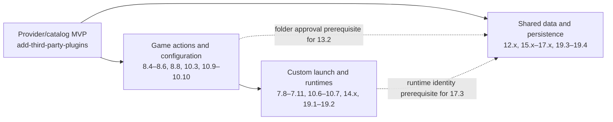

# Third-party plugin delivery split

The original 128-task program is now split into a provider/catalog MVP and three follow-up changes. Completed work remains in [`tasks.md`](tasks.md); each remaining task has exactly one implementation owner below. The detailed original design and delta specs remain the program-level contract reference. A contract existing there does not mean its endpoint ships in the MVP.

## MVP scope: provider and catalog

Change: [`add-third-party-plugins`](.)

The MVP enables managed signed package import, provider composition, account-bound plugin sessions, external account/login isolation, provider discovery/catalog/counters, library read/presentation endpoints, permission and publisher review, activation controls, staged update recovery, public SDK distributions and focused Go/Rust provider examples.

MVP completion criteria include Linux and Windows native acceptance and preserving the official Steam and PackageKit behavior. The MVP does **not** expose launch/install requests, plugin filesystem access, folder approvals, custom launch, runtime registration, shared datasets, telemetry or managed durable persistence. Update downgrade/re-trust policy is deferred; MVP updates are limited to staged activation and last-known-good recovery. Methods outside the MVP surface must be omitted from `DescribeApi` and return `UNIMPLEMENTED` when not implemented.

| MVP endpoint family | MVP behavior |
| --- | --- |
| `PluginHost.OpenSession`, `DescribeApi`, `GetPermissions`, `WatchPermissionChanges` | Authenticated session and own API/grant introspection |
| `ProviderHost.GetContext`, `Exchange` | Provider-scoped account/login, discovery, catalog, counter and status exchange |
| `Library.List/Get/Watch` | Bounded library projection |
| `Metadata.Update`, favorites, matching and artwork methods already supported | Provider-owned presentation and catalog matching under existing grants |
| Package import, inventory and permission/settings commands | Host UI and Tauri APIs, not plugin RPC methods |

NetworkFetch, Files, Saves, Locations, Tools, Ports and Backups are not MVP endpoints. Standard/custom launch and installation requests are not available to third-party plugins in this release slice; official providers retain their existing behavior.

### MVP tasks retained in the original checklist

`8.1–8.3`, `8.7`, `9.3`, `10.1–10.2`, `10.4–10.5`, `10.8`, `11.1–11.3`, `11.5–11.7`, `11.9`, `18.1–18.4`, and MVP-scoped `18.10`.

## Follow-up A: actions and configuration

Change: [`third-party-plugin-actions-and-configuration`](../third-party-plugin-actions-and-configuration/)

Source tasks: `8.4–8.6`, `8.8`, `10.3`, `10.9–10.10`, `11.4`. This adds plugin Configure windows/forms, persistent network-origin approval, host-confirmed launch/install intents and folder approval/revocation. It depends on MVP identity/session, permission and inventory foundations.

## Follow-up B: custom launch and runtimes

Change: [`third-party-plugin-custom-launch-runtimes`](../third-party-plugin-custom-launch-runtimes/)

Source tasks: `7.8–7.11`, `10.6–10.7`, `11.8`, `14.2–14.5`, `18.5`, `18.8–18.9`, `19.1–19.2`, `19.5`. This includes the existing uncommitted partial implementation of 7.8; it remains local and must be preserved. It depends on MVP and on host-issued action confirmation from Follow-up A.

## Follow-up C: shared data and persistence

Change: [`third-party-plugin-data-and-persistence`](../third-party-plugin-data-and-persistence/)

Source tasks: `9.4`, `12.1–12.7`, `13.2`, `15.1–15.4`, `16.1–16.5`, `17.1–17.4`, `18.6–18.7`, `19.3–19.4`. This adds consented producer/consumer datasets, diagnostics and gameplay telemetry, owner-scoped persistence, quotas, retention, cleanup and downgrade/re-trust data policy. It depends on MVP identity and grant fencing; backup coordination 13.2 waits for folder approvals in Follow-up A, and the shared-runtime example 17.3 waits for runtime identity in Follow-up B. Most data-plane work can proceed in parallel with Follow-ups A and B after the MVP.

## Dependency diagram

The open source task IDs are preserved in each follow-up task as `Source N.N` references. Do not mark the corresponding old task complete until its follow-up is implemented; the tasks are moved so OpenSpec progress is counted once.
