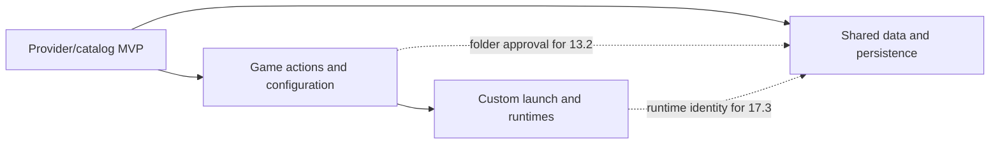
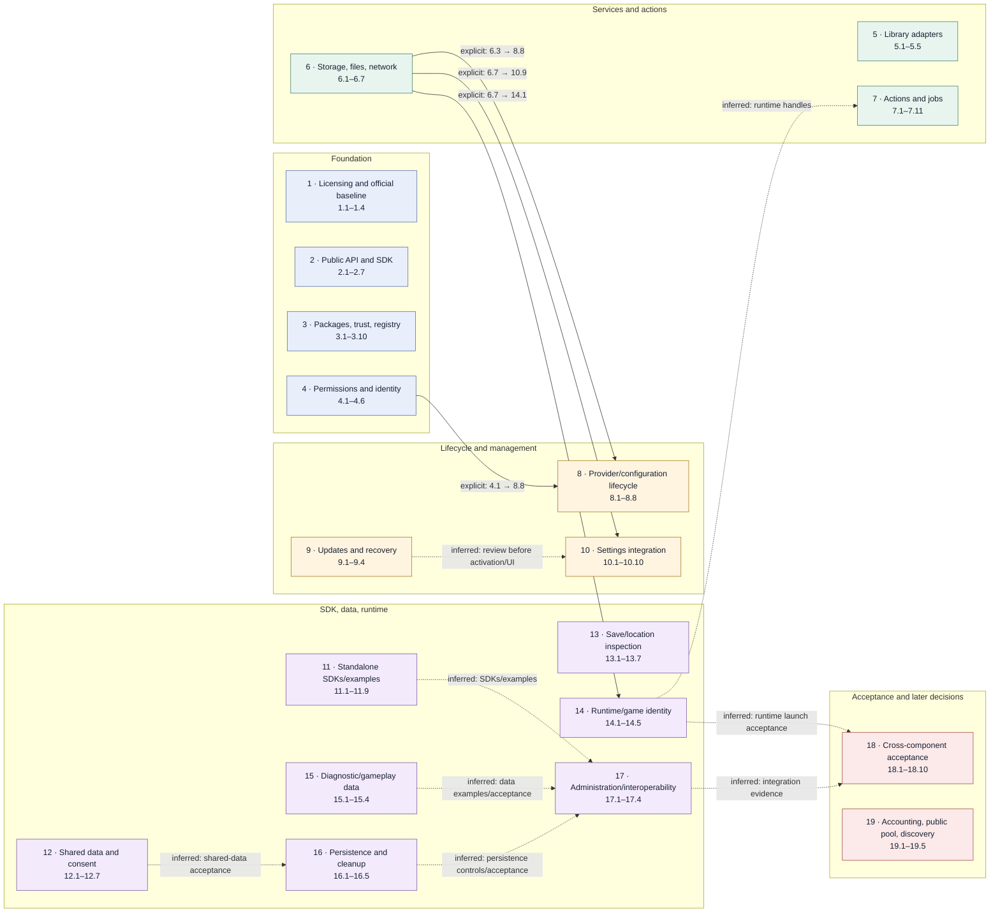
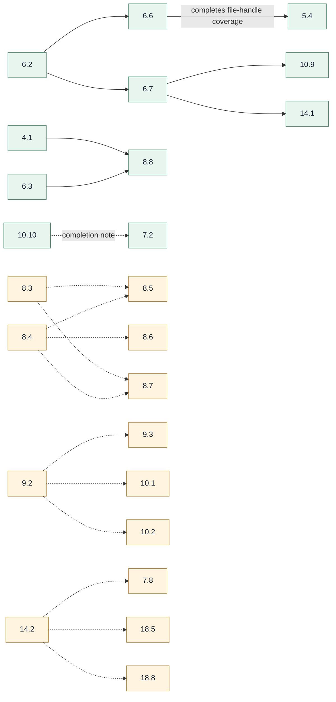

# Dependency map

This document summarizes task-level dependencies for the complete plugin program. The first release slice and follow-up ownership are defined in [`delivery-split.md`](delivery-split.md); each OpenSpec task checklist remains the source of truth for its assigned task status.

For planning ranges and model suggestions, see [effort-estimates.md](effort-estimates.md).

## Delivery-change dependencies

See [`delivery-split.md`](delivery-split.md) for endpoint boundaries and source-task mapping. Most shared-data work can proceed alongside launch/runtime work after the MVP. Task 13.2 waits for folder approvals; task 17.3 waits for runtime identity.

The checklist declares only a small number of task-level dependencies. The diagram groups all task IDs by section and shows the most relevant cross-task paths. **Solid edges** are stated in the change artifacts. **Dotted edges** are planning inferences from task scope or completion notes; they are not new requirements or blockers unless the task artifacts are updated to say so.

The section diagram groups tasks rather than asserting that every task in one section blocks every task in a connected section. These are the task-level edges represented in the map:

## Task-level relationships

### Explicit in the task artifacts

- **6.2 → 6.6**: artwork accepts the approved file handles introduced by 6.2. Task 6.6 says it completes the file-handle portion of 5.4.
- **6.2 → 6.7**: declared save/prefix locations are suggestions only and use the folder-approval flow from 6.2.
- **4.1 + 6.3 → 8.8**: 8.8 connects approved HTTPS origins to persisted per-account grants.
- **6.7 → 10.9**: installation/folder suggestions feed the settings approval flow.
- **6.7 → 14.1**: suggested library roots follow the same closed-placeholder and approval rules.
- **10.10 → 7.2**: the completion note for 7.2 records that custom/standard launch confirmation uses the on-request intent flow from 10.10.

### Inferred from the requirements and completion notes

- **8.3 + 8.4 → 8.5, 8.6, 8.7**: session/window lifecycle and `ui.configure` are foundations for fencing windows, selecting external versus declarative configuration, and validating lifecycle fixtures/documentation.
- **9.2 → 9.3, 10.1, 10.2**: update review and approval precede staged activation/rollback and the UI's update state/actions.
- **14.2 → 7.8, 18.5, 18.8**: approved runtime resources are needed to complete custom launch runtime handles and runtime-wrapper/overlay acceptance.
- **11.x → 17.3–17.4 → 18.x**: standalone SDK distributions and examples feed interoperability and cross-component checks.
- **12.x, 15.x, 16.x → 17.x → 18.x**: shared data, produced data and persistence feed administration/examples and combined acceptance scenarios.
- **Implementation sections → 18.x**: section 18 is an acceptance sweep over implemented contracts; each 18.x task should be tied to the relevant feature tasks when its exact scope is reviewed.

These inferred paths are navigation aids. Before treating one as a blocking dependency, record it in `tasks.md` and review the affected tasks for ordering and scope.
