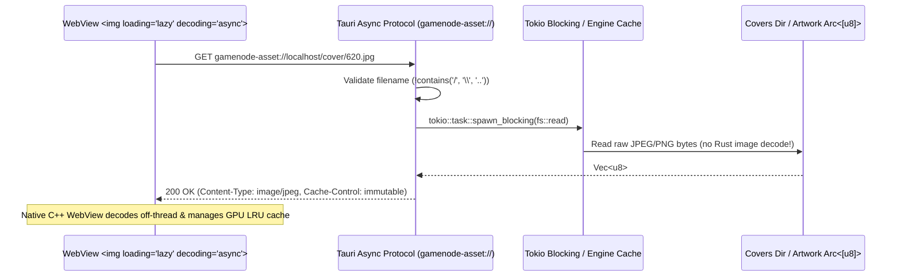
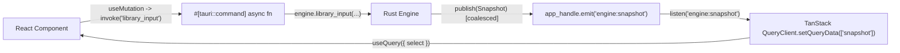

# Design

## Context

GameNode Desktop has a clean separation between its pure domain (`crates/core`), OS/database/process adapters (`crates/platform`), HTTP client (`crates/api`), and background coordinator (`crates/app/src/engine/*`). However, the presentation layer in `crates/app` (`ui/*.slint`, `src/library_ui.rs`, `src/library_ui/artwork.rs`, `src/ui_commands.rs`, and `examples/ui-review.rs`) was built with Slint. Because Slint's `Image` and `Model` types are bound to the UI thread (`!Send`) and its `ListView` only virtualizes outer rows, every decoded cover triggered a full `Snapshot` re-render on the main event loop and retained uncompressed RGBA8 buffers in an unbounded `HashMap`. See `proposal.md` for motivation and scope.

## Goals / Non-Goals

**Goals:**
- Execute a **hard cutover** that deletes all `.slint` files, Slint Rust glue (`library_ui*`, `ui_commands.rs`), the Slint headless studio (`examples/ui-review.rs`, `scripts/dev-screen.sh`), and the Skia/software fallback loop without keeping dual UI implementations.
- Guarantee **by construction** that AI agents and contributors cannot block the UI thread or leak uncompressed image buffers in Rust:
  1. All frontend-to-backend calls go through `#[tauri::command] async fn` handlers running on Tokio worker threads.
  2. All covers and landscape artwork stream directly via a custom `gamenode-asset://` URI scheme to `` so the WebView's native C++/GPU compositor manages off-thread decoding and hardware LRU texture eviction.
  3. All large lists and grids use `@tanstack/react-virtual`.
  4. All backend state synchronization in React flows through `@tanstack/react-query` updated by coalesced Tauri events.
- Preserve 100% of the business logic, SQLite database compatibility (`0001`..`0005`), single-instance IPC, `app.gamenode://` deep links, background playtime tracking, Ludusavi save protection, and OptiScaler Game Tools.

**Non-Goals:**
- Changing any server API contract (`crates/api`), SQLite table schemas (`crates/platform/migrations`), or provider manifest formats (`providers/*.toml`).
- Supporting dual Slint and Tauri builds or keeping `ui-review.rs` around.

## Decisions

### 1. Direct `serde` Serialization on `gamenode-core` View & Input Types

**Decision:** Add `#[derive(Serialize, Deserialize)]` with `#[serde(rename_all = "camelCase")]` directly to `gamenode-core`'s view and command structs (`Snapshot`, `AuthView`, `LibraryView`, `Row`, `DetailView`, `MatchDialogView`, `AddDialogView`, `LocalView`, `ToolsView`, `Input`, `library::Input`, etc.), with one critical adjustment to `DetailView`:
- In `gamenode-core::library::DetailView`, replace raw `artwork: Option<Arc<[u8]>>` in the serialized DTO (or skip serializing the raw byte slice via `#[serde(skip)]` and expose `has_artwork: bool` + `artwork_url: Option<String>`).
- The raw `Arc<[u8]>` stays inside `Engine` so the `gamenode-asset://localhost/artwork/<game_id>` protocol handler can serve the bytes directly with HTTP `Content-Type` and `ETag`/`Cache-Control` headers instead of serializing megabytes of JSON byte arrays over IPC on every snapshot.

**Rationale:** Eliminates ~1,700 lines of error-prone manual struct-to-struct copying in `library_ui.rs` and prevents large binary blobs from crossing the JSON IPC bridge.
**Alternatives considered:** Writing a parallel set of DTO structs in `crates/app`. Rejected because `gamenode-core`'s `Snapshot` and `LibraryView` are already clean, immutable view models designed specifically for UI consumption.

### 2. Custom `gamenode-asset://` Protocol for Zero-Copy Off-Thread Images

**Decision:** Register a custom Tauri URI scheme protocol `gamenode-asset://` in `crates/app/src/protocol.rs` using `tauri::Builder::register_asynchronous_uri_scheme_protocol("gamenode-asset", ...)`:

- **Covers (`gamenode-asset://localhost/cover/<file>`)**:
  - Validates `file` using the existing `valid_cover_file` rule (`!file.contains(['/', '\\']) && !file.starts_with('.')`).
  - Reads the raw compressed JPEG/PNG file from `covers_dir` on Tokio's blocking pool without decoding it in Rust.
  - Returns `Response::builder().header("Content-Type", mime).header("Cache-Control", "public, max-age=31536000, immutable")`.
- **Landscape Artwork (`gamenode-asset://localhost/artwork/<game_id>?rev=<len_or_hash>`)**:
  - Reads the `Arc<[u8]>` held in `Engine` for `<game_id>` (zero disk I/O, zero JSON base64 encoding) and returns the raw compressed image bytes to the WebView.
- Remove the `image` crate from `crates/app/Cargo.toml` completely.

**Rationale:** This directly fixes the 600MB–1.3GB memory spike and UI stutter. Rust never allocates uncompressed RGBA8 pixel buffers, and the browser engine's compositor automatically decodes only visible `` elements off-thread and evicts off-screen GPU textures under memory pressure.
**Alternatives considered:** Using Tauri's generic `asset://` (`protocol-asset`) with full filesystem paths. Rejected because a dedicated `gamenode-asset://` protocol enforces strict filename validation (`valid_cover_file`) without exposing arbitrary filesystem paths to the frontend, and can also serve in-memory `Arc<[u8]>` landscape artwork.

### 3. Event-Driven `@tanstack/react-query` State Architecture

**Decision:** Combine Tauri events with `@tanstack/react-query` as the single source of truth in `ui/`:

- **Coalesced Backend Emission:** Retain the proven `publish_snapshot` coalescing pattern from `main.rs`, adapted to emit `app_handle.emit("engine:snapshot", &snapshot)` at most once per Tokio tick / frame window when multiple engine transitions happen back-to-back.
- **Initial Bootstrap + Live Stream:**
  - `useSnapshotQuery` fetches the initial state via `invoke<Snapshot>('get_snapshot')` (`staleTime: Infinity`).
  - A singleton listener initialized at app startup calls `queryClient.setQueryData(['snapshot'], event.payload)` whenever `"engine:snapshot"` arrives.
  - Feature hooks (`useAuth()`, `useLibraryView()`, `useLocalGames()`, `useTools()`, `useSettings()`) use TanStack Query's `select` option with structural sharing so that, for example, a playtime tick in `LibraryView` does not re-render `SettingsModal` or `TopBar`.
- **Transient UI State in `@tanstack/react-store`:**
  - Purely visual/ephemeral state that does not belong in `Engine`—such as live drag width during sidebar/detail pane resizing, open context menu `{ x, y, entryKey }`, active `SettingsTopic`, license modal visibility, and unsaved backup destination input—lives in a lightweight `@tanstack/react-store` store.

**Rationale:** Gives AI agents a rigid, well-known React + TanStack Query pattern where reading state is always `useQuery` and mutating state is always `useMutation` over an async `invoke()`.
**Alternatives considered:** Polling `get_snapshot` on a timer or creating dozens of separate backend events per field. Rejected because `Engine` already computes a consistent, generation-tracked `Snapshot` on state transitions.

### 4. True Grid and List Virtualization with `@tanstack/react-virtual`

**Decision:**
- **`GameGrid` (`ui/src/features/library/GameGrid.tsx`)**:
  - Observe the scroll container width via `ResizeObserver` and compute `columns = Math.max(1, Math.floor((width - 12) / (166 + 12)))`.
  - When `columns` changes, fire `invoke('library_input', { input: { setColumns: columns } })` so `LibraryMachine`'s `Move { Up | Down }` math matches the visual grid.
  - Configure `useVirtualizer({ count: Math.ceil(rows.length / columns), getScrollElement, estimateSize: () => 294 + 12, overscan: 3 })`.
  - Render only the virtual rows; each virtual row renders `columns` `GameTile` cards (`166x294px`).
- **`GameList` (`ui/src/features/library/GameList.tsx`)**:
  - Configure `useVirtualizer({ count: rows.length, getScrollElement, estimateSize: () => 48, overscan: 6 })`.
- **Keyboard Focus Reveal**:
  - A `useEffect` watching `libraryView.focusedIndex` calls `virtualizer.scrollToIndex(focusedRowIndex, { align: 'auto' })`, replacing the manual `list.content-y` arithmetic from `library.slint`.

**Rationale:** Ensures DOM node count stays constant (~25–45 tiles) whether the user has 20 or 5,000 games, with 120Hz scrolling handled by the WebView's GPU compositor thread.

### 5. Single-Instance, Deep Links, Background Mode, and Native Tray in Tauri v2

**Decision:** Keep `gamenode_platform::ipc` (`acquire`, `forward_launch`, `Endpoint::for_current_user`) at the very start of `main()` before `tauri::Builder` initializes the WebView:
- If an instance is already running, `ipc::forward_launch` sends `Activate` or `AuthCallback { url }` to the owner over the existing named pipe / Unix socket and exits immediately in <5ms (without ever spawning a second WebView process).
- In the owner process:
  - A Tokio task reads `owner.messages`: on `AuthCallback { url }`, it calls `engine.dispatch(Input::CallbackReceived(url))`; unless started with `--background`, it un-hides, un-minimizes, and focuses the main `WebviewWindow`.
  - When started with `--background`, the `WebviewWindow` is created with `.visible(false)` (or not shown until activated from the tray or a second launch), while `Engine` and the 1-second Tokio maintenance ticker (`engine.dispatch(Input::Tick); engine.maintenance();`) run in the background.
  - On Windows, `TrayIconBuilder` creates the system tray icon with localized menu items (`Open GameNode` / `Abrir o GameNode` and `Quit` / `Sair`) and updates its tooltip (`GameNode` or `GameNode — <running title>`) when `snapshot.tracking.title` changes.
  - On Windows, `WindowEvent::CloseRequested` saves the current `WindowGeometry`, calls `api.prevent_close()`, and hides the window (`window.hide()`). On Linux (MVP behavior per `desktop-lifecycle`), closing the window calls `engine.shutdown()` and exits.

**Rationale:** Keeping `gamenode_platform::ipc` preserves 100% of the tested Windows/Linux single-instance and `app.gamenode://` security guarantees (`crates/platform/tests/instance_processes.rs`) while letting Tauri manage the window and tray.

### 6. Design Tokens, Fonts, and Localization (`en` / `pt-BR`)

**Decision:**
- Move `crates/app/ui/theme-provenance.json`, `crates/app/ui/fonts/Roboto-Variable.ttf`, and SVG/ICO icons (`gamenode-logo.svg`, `gamenode.ico`, `gamenode.png`, `library.svg`, `arrow.svg`, etc.) into `ui/src/assets/` and `crates/app/icons/`.
- Generate CSS custom properties in `ui/src/styles/theme.css` directly from the Version 3.0 and Settings modal (`4987:10202`) token values so provenance remains auditable.
- Migrate every translation string from `i18n/en/LC_MESSAGES/gamenode-app.po` and `i18n/pt_BR/LC_MESSAGES/gamenode-app.po` into strongly typed TypeScript dictionaries (`ui/src/i18n/en.ts` and `ui/src/i18n/pt-BR.ts`, where `pt-BR.ts` satisfies `typeof en`). The active locale is resolved from the OS locale passed by the Rust host (`system_locale()`) with runtime switching support for tests and preview.

## Risks / Trade-offs

- **[Risk] Native file/folder pickers blocking the UI if called on the window thread** → **Mitigation:** All file/folder dialogs (`pick_local_executable`, `pick_save_location`, `pick_local_watch_folder`, `pick_local_saves`) are invoked inside `#[tauri::command] async fn` using `tokio::task::spawn_blocking` (or `Engine`'s background thread), never on the main window event loop.
- **[Risk] Stale databases containing `renderer = 'software'` or `'gpu'` in `foundation_settings`** → **Mitigation:** Keep the `renderer` column in `0001_initial_settings.sql` so existing SQLite databases open without checksum or schema errors, and ignore the column when loading/saving `Settings`.
- **[Risk] Windows cross-compilation from WSL (`cargo xwin`) with Tauri v2** → **Mitigation:** Configure `crates/app/Cargo.toml` and `tauri.conf.json` to embed the prebuilt `ui/dist` assets (`frontendDist: "../../ui/dist"`), and update `scripts/build-windows-wsl.sh` and `scripts/package-windows-wsl.sh` to run `pnpm --dir ui build` prior to `cargo xwin build`.

## Migration Plan

1. **Step 1 (Purge & Bootstrap):** Delete all `.slint` files, `library_ui*`, `ui_commands.rs`, `ui-review.rs`, `scripts/dev-screen.sh`, `crates/app/tests/*`, and `.po` files. Remove `slint`, `slint-build`, and `image` from Cargo manifests. Scaffold `ui/` (Vite + React + TS + TanStack) and Tauri v2 config in `crates/app`.
2. **Step 2 (IPC & Asset Protocol):** Add `serde` derives to `gamenode-core` views/inputs, implement `gamenode-asset://` in `crates/app/src/protocol.rs`, implement `#[tauri::command] async fn` handlers in `crates/app/src/commands.rs`, and wire `useSnapshot` + TanStack Query in `ui/src/api/`.
3. **Step 3 (Lifecycle, Tray, Shell, Auth & Settings):** Wire `crates/app/src/main.rs` (IPC, geometry, tray, close-to-tray, 1s maintenance task) and implement `TopBar`, `Sidebar`, `AppMenu`, `SignedOutView`, `SyncExplanationModal`, and `SettingsModal` in React.
4. **Step 4 (Virtualized Library, Detail Pane & Dialogs):** Implement `LibraryToolbar`, `GameGrid` and `GameList` with `@tanstack/react-virtual`, keyboard navigation, multi-select, `ContextMenu`, `DetailPane`, `MatchDialog`, and `AddDialog`.
5. **Step 5 (DRM-Free, Save Protection & Game Tools):** Implement `LocalGameEditor`, `DiscoveryModal`, `SaveProtectionModal` (with restore preview), `ClaimConflictModal`, `RemoveLocalGameModal`, and `GameToolsModal` (OptiScaler).
6. **Step 6 (Tests, Packaging & Guardrails):** Add Vitest + React Testing Library suites, update Windows/Linux packaging scripts, and update `AGENTS.md`, `docs/development.md`, and `docs/mvp-roadmap.md`.
